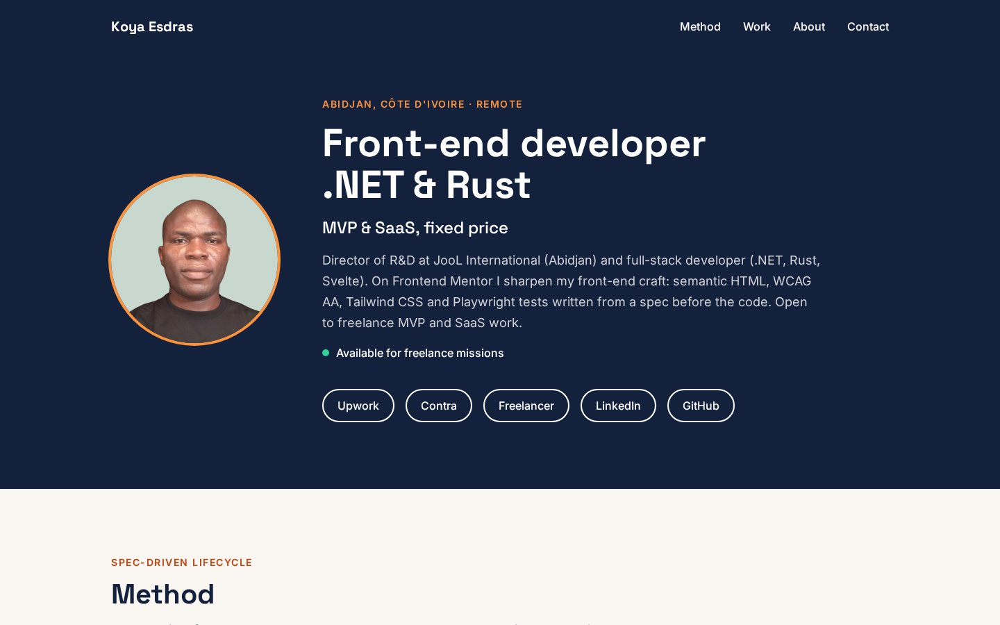

# Koya Esdras — portfolio

My one-page portfolio: who I am, how I work, my products and my Frontend Mentor solutions, with links to my freelance profiles.



## Table of contents

- [Links](#links)
- [What's on the page](#whats-on-the-page)
- [Built with](#built-with)
- [Workflow](#workflow)
- [Run and test](#run-and-test)
- [AI Collaboration](#ai-collaboration)
- [Author](#author)

## Links

- Live site: [ounokoya.github.io](https://ounokoya.github.io/)
- Specs, mockup and decisions: [`specs/`](./specs/)

## What's on the page

- **Hero**: photo, positioning (front-end developer, .NET & Rust, MVP & SaaS at a fixed price), availability, and links to Upwork, Contra, Freelancer, LinkedIn and GitHub.
- **Method**: my Spec-Driven Lifecycle in four steps.
- **Work**: my products LaunchKit and Radar, then 6 featured Frontend Mentor solutions and the 8 others, each with its live site, code and Frontend Mentor page.
- **About** and **Contact**: links only, no e-mail or phone number for bots to collect.

## Built with

- Semantic HTML5, no JavaScript at all (the page has no script)
- [Tailwind CSS v4](https://tailwindcss.com/), with the mockup's tokens in `@theme`
- [Vite](https://vite.dev/) for the build
- Space Grotesk and Inter from [Fontsource](https://fontsource.org/), served with the site
- [Playwright](https://playwright.dev/), [axe-core](https://github.com/dequelabs/axe-core), the [W3C Nu validator](https://validator.github.io/validator/), html-validate and eslint

## Workflow

The same spec-driven method as my Frontend Mentor solutions:

1. Choices and plan, validated before any file: English only, products and Frontend Mentor solutions, links only, a photo.
2. A [Penpot mockup](./specs/visuel/penpot/maquette.md) at 1440 and 375 px, with its library, components and link states, validated before the spec.
3. A [written spec](./specs/specifications/portfolio.md) with 24 acceptance criteria, and its tests written **before** the code. They failed first, for the right reason.
4. [Architecture decisions](./specs/adr/v1.0/): tokens, fonts, a static page, images, layout, publication.
5. The code, then a [real-browser walkthrough](./specs/analyse/2026-11-06-portfolio.md) at 320, 375, 768 and 1440 px: keyboard, first load, console.

Each section of the page is compared with the mockup pixel by pixel: 1.3 to 4.5 % of pixels differ, under the 5 % threshold. The exception is the mobile About text, at 7.6 %: Penpot places its text lines about 0.3 px lower than CSS, and that section is almost all text.

## Run and test

```bash
npm install
npm run dev      # local server
npm test         # 34 tests on the production build
npm run deploy   # publishes dist/ to the gh-pages branch
```

Photos and screenshots are prepared once by `scripts/images.py` (Python and Pillow) from `specs/reference/images/`.

## AI Collaboration

I used **Claude (Claude Code)** as a pair, inside my own spec-driven workflow where I validated each step before the next one:

- **Planning**: Claude asked me four questions (language, works shown, contact, photo) and drew the page and the plan; I validated both before any file was created.
- **Content**: the bios come from my LinkedIn and freelance profiles, which I had validated; Claude proposed the new texts and I validated them with the mockup.
- **Mockup**: built by Claude in Penpot; I chose to keep all its proposals (colours, fonts, two-line title, navigation, tablet layout).
- **Spec, tests and decisions**: written by Claude before any code, from the validated mockup.
- **Code**: written by Claude from the spec — I gave my agreement at the code lock — with the tests run at each step.

What worked well: comparing each section with the mockup showed three spacing mistakes and two Penpot text quirks before I looked at the page. What needed my decisions: the four choices, the mockup, and the publication.

## Author

- Website: [ounokoya.github.io](https://ounokoya.github.io/)
- Frontend Mentor: [@ounokoya](https://www.frontendmentor.io/profile/ounokoya)
- GitHub: [@ounokoya](https://github.com/ounokoya)
- LinkedIn: [Koya Esdras](https://www.linkedin.com/in/koya-esdras-4b554b142)
