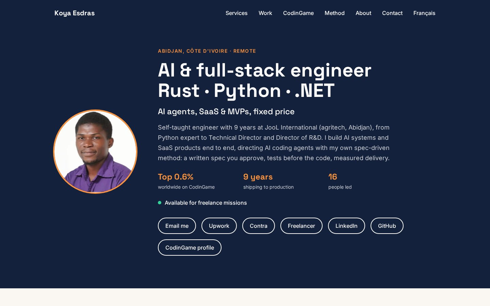

# Koya Esdras — freelance portfolio

My freelance portfolio, in English and in French: what I build, my work, my CodinGame rankings, how I work, and how to reach me.



## Table of contents

- [Links](#links)
- [What's on the page](#whats-on-the-page)
- [Built with](#built-with)
- [Workflow](#workflow)
- [Run and test](#run-and-test)
- [AI Collaboration](#ai-collaboration)
- [Author](#author)

## Links

- Live site: [ounokoya.github.io](https://ounokoya.github.io/) (English) · [ounokoya.github.io/fr/](https://ounokoya.github.io/fr/) (French)
- Specs and decisions: [`specs/`](./specs/)

## What's on the page

- **Hero**: photo, positioning (AI & full-stack engineer, Rust · Python · .NET), three key figures, availability, an e-mail link and my freelance profiles.
- **Services**: AI agents & LLMs, SaaS & MVPs, back end & infrastructure, algorithms & performance.
- **Work**: my products LaunchKit and Radar, two R&D systems I built at JooL International, and three Frontend Mentor solutions.
- **CodinGame**: my rank (top 0.6% worldwide, Master title) and my best leagues in bot programming.
- **Method**, **About** and **Contact**, with a `mailto:` link.
- A language link in the header switches between the English (`/`) and French (`/fr/`) pages.

## Built with

- Semantic HTML5, no JavaScript at all: one static page per language
- [Tailwind CSS v4](https://tailwindcss.com/), with the design tokens in `@theme`
- [Vite](https://vite.dev/) in multi-page mode for the build
- Space Grotesk and Inter from [Fontsource](https://fontsource.org/), served with the site
- [Playwright](https://playwright.dev/), [axe-core](https://github.com/dequelabs/axe-core), the [W3C Nu validator](https://validator.github.io/validator/), html-validate and eslint

## Workflow

The same spec-driven method as my client work:

1. Choices and plan, validated before any file ([brainstorming](./specs/brainstorming/2026-11-17-portfolio-freelance.md)): two languages, no client project without consent, no prices, an e-mail link.
2. The [texts of both pages](./specs/reference/contenu-v2.md) and a [written spec](./specs/specifications/portfolio.md) with its acceptance criteria.
3. [Architecture decisions](./specs/adr/v2.0/): one static page per language, no new mockup, contact by e-mail.
4. The code, then tests run on both pages: content, links, keyboard order, layout from 320 to 1920 px, accessibility, validators.
5. A real-browser review of both pages at 1440 and 375 px.

Version 1 (front-end portfolio, compared pixel by pixel with a Penpot mockup) is kept in [`specs/specifications/archive/`](./specs/specifications/archive/).

## Run and test

```bash
npm install
npm run dev      # local server
npm test         # 54 tests on the production build, both languages
npm run deploy   # publishes dist/ to the gh-pages branch
```

The photo and screenshots are prepared once by `scripts/images.py` (Python and Pillow) from `specs/reference/images/`.

## AI Collaboration

I used **Claude (Claude Code)** as a pair, inside my own spec-driven workflow where I validated each step before the next one:

- **Planning**: Claude proposed the new structure; I decided the languages, what not to show (a client project, prices) and the e-mail contact.
- **Content**: the figures come from my CV and my public CodinGame profile; Claude wrote both languages from them.
- **Spec, tests and decisions**: written by Claude, then the code, with the tests run at each step. The tests caught a contrast issue (an orange label on a sand background, 4.4:1) and a table too wide at 320 px.
- **Review and publication**: my decisions.

## Author

- Website: [ounokoya.github.io](https://ounokoya.github.io/)
- E-mail: [koya.esdras@gmail.com](mailto:koya.esdras@gmail.com)
- CodinGame: [elsek](https://www.codingame.com/profile/6eb42e4339ad9f5038bbbf71d326d27c0031484)
- GitHub: [@ounokoya](https://github.com/ounokoya)
- LinkedIn: [Koya Esdras](https://www.linkedin.com/in/koya-esdras-4b554b142)
